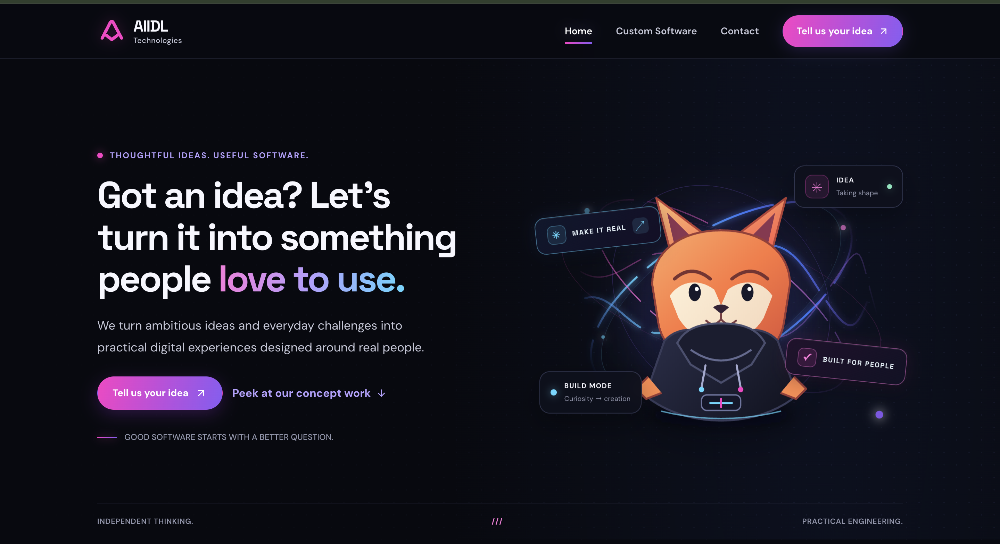
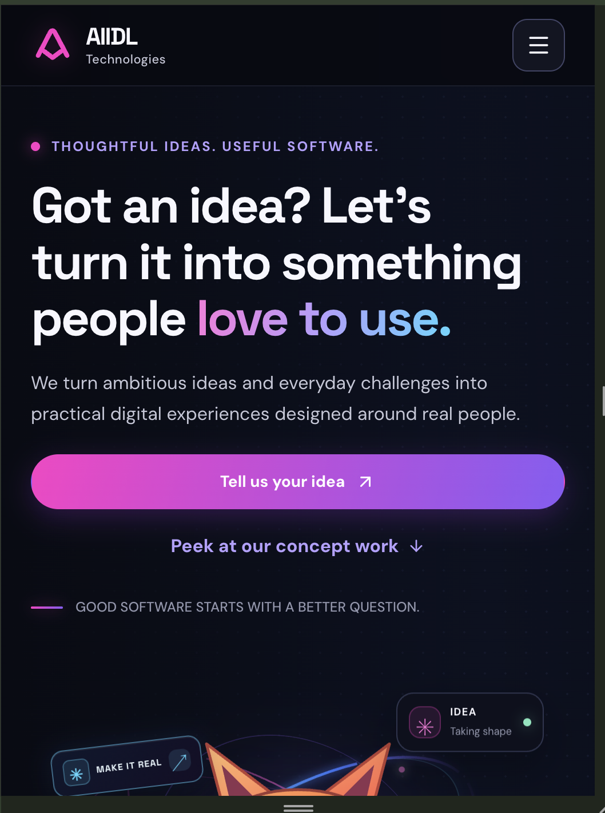

# AIIDL Technologies — Frontend & UI/UX Assignment

A modern, responsive website developed as part of the AIIDL Technologies Frontend & UI/UX assignment. The project focuses on presenting services, showcasing conceptual projects, and providing a straightforward contact experience.

## Live Demo

- **Live Website:** https://aiidl-website-ndiolyl3r-techno5.vercel.app/
- **GitHub Repository:** https://github.com/Nikkiraj4/aiidl-website

## Project Overview

The objective of this project is to create a polished, user-friendly website with clear navigation, a distinctive visual identity, responsive layouts, and interactive frontend elements.

The website consists of three main pages:

- **Home:** Introduces the brand, presents services and conceptual projects, and guides visitors toward relevant calls to action.
- **Service Detail:** Presents service information, deliverables, and the project approach.
- **Contact:** Provides a contact form with input validation and demo-only submission feedback.

## Tech Stack

- **React** — Component-based UI development.
- **Vite** — Development server and production build tooling.
- **JavaScript (ES6+)** — Application logic and interactions.
- **CSS3** — Styling, layouts, responsive design, and visual effects.
- **React Router** — Client-side navigation.
- **Lucide React** — Interface icons.

## Getting Started

### Prerequisites

- Node.js
- npm
- Git (for cloning the repository)

### Installation

Clone the repository:

```bash
git clone https://github.com/Nikkiraj4/aiidl-website.git
cd aiidl-website
```

Install dependencies:

```bash
npm install
```

Start the development server:

```bash
npm run dev
```

Open the local URL displayed in your terminal, usually `http://localhost:5173`.

### Production Build

Create an optimized production build:

```bash
npm run build
```

Preview the production build locally:

```bash
npm run preview
```

The generated production files are stored in the `dist/` directory.

## Design Concept

The design follows a contemporary, technology-focused visual direction. It combines strong typography, contrasting colours, structured content sections, visual elements, and consistent spacing to create a distinctive interface.

The experience prioritizes clear communication and straightforward navigation while maintaining a consistent visual identity across all three pages.

### Key Design Decisions

**1. Clear visual hierarchy**

The homepage presents the main message and calls to action prominently before introducing services and conceptual projects. This helps visitors understand the website's purpose and find relevant information quickly.

**2. Reusable components**

Shared components, including the navigation bar and footer, maintain consistency across pages. Separating components and page styles into individual files also improves maintainability.

**3. Responsive layouts**

The interface uses responsive styling to adapt to different screen sizes while aiming to preserve readability, usability, and visual consistency across desktop and mobile devices.

**4. Form feedback**

The contact page includes input validation to help users identify missing or invalid information before submitting the form.

## Project Structure

```text
aiidl-website/
├── public/
│   ├── favicon.svg
│   └── icons.svg
├── src/
│   ├── assets/
│   │   ├── hero.png
│   │   ├── react.svg
│   │   └── vite.svg
│   ├── components/
│   │   ├── Footer.jsx
│   │   ├── Footer.css
│   │   ├── HeroVisual.jsx
│   │   ├── HeroVisual.css
│   │   ├── Navbar.jsx
│   │   └── Navbar.css
│   ├── pages/
│   │   ├── Home.jsx
│   │   ├── Home.css
│   │   ├── ServiceDetail.jsx
│   │   ├── ServiceDetail.css
│   │   ├── Contact.jsx
│   │   └── Contact.css
│   ├── App.jsx
│   ├── main.jsx
│   ├── index.css
│   └── styles.css
├── .gitignore
├── README.md
├── index.html
├── package.json
├── package-lock.json
└── vite.config.js
```

## Features

- Three-page website experience.
- Navigation between Home, Service Detail, and Contact.
- Service information and calls to action.
- Conceptual project showcase.
- Contact form with input validation.
- Responsive CSS styling.
- Reusable React components.
- Production build using Vite.
- Deployment through Vercel.

## Testing

- Production build verified successfully using `npm run build`.
- Navigation, responsive layouts, and contact form validation should be tested manually before final submission.
- Live deployment: https://aiidl-website-ndiolyl3r-techno5.vercel.app/

**Contact form limitation:** The contact form is a frontend demonstration. It is not connected to a backend or email service, and submissions are not stored. Any success message is demo-only confirmation; no message is actually sent.

## Screenshots


```markdown
### Desktop Homepage



### Mobile Homepage


```

## AI and Reference Disclosure

AI assistance was used during development to support implementation, troubleshoot styling issues, and improve the organization and presentation of the project.

**Representative prompt:**

> Help me develop a modern, responsive React website for a technology company, with a homepage, service detail page, and contact page. Use reusable components, clear visual hierarchy, responsive styling, and intuitive calls to action.

AI-assisted suggestions were reviewed and adapted to the project structure. Styling adjustments were made to improve the visibility of section headings and contact form labels. A production build was run to verify that the project compiled successfully.

Any additional external references or AI tools used should be disclosed accurately.

## Limitations and Future Improvements

- Connect the contact form to a backend or email service for real submissions.
- Add automated tests for navigation and form validation.
- Expand accessibility and cross-browser testing.
- Remove unused starter assets where appropriate.


## Author

**Nikita Kumari**

- **GitHub:** https://github.com/Nikkiraj4
- **Project Repository:** https://github.com/Nikkiraj4/aiidl-website
- **Live Website:** https://aiidl-website-ndiolyl3r-techno5.vercel.app/

---

*Developed as a frontend and UI/UX assignment for AIIDL Technologies.*
